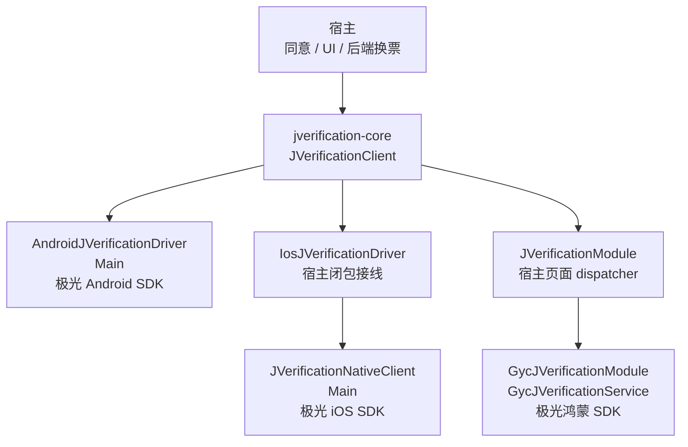
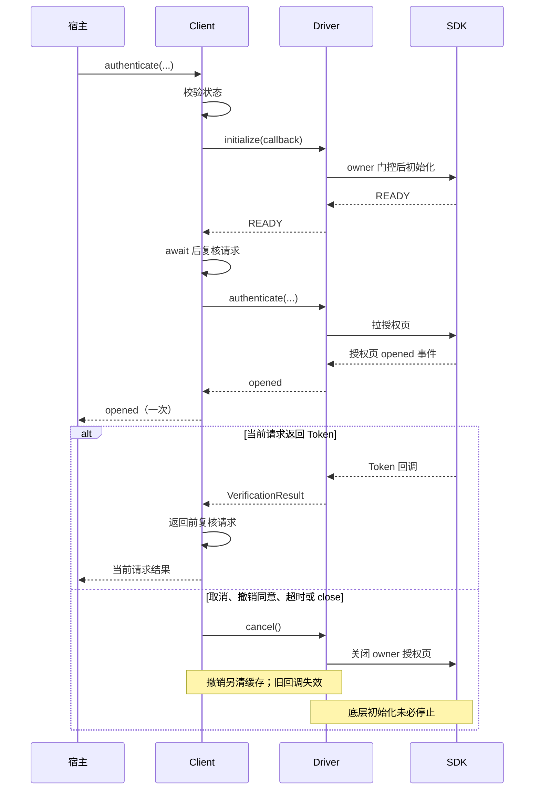
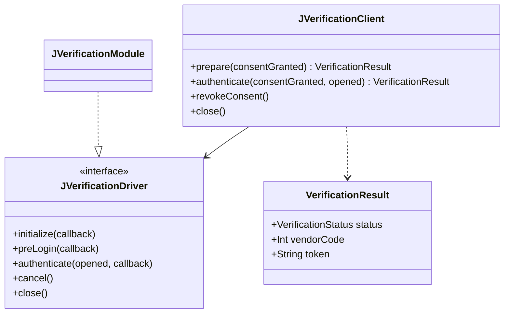

# GY CrossKit JVerification

> 当前源码候选统一为 **1.0.0**：Maven（core/Kuikly）、iOS Pod 与 OHPM 使用同版；尚未发布，示例坐标须待发布后远程消费。本地验证使用显式源码/本地 HAR，Kuikly 基线为 2.29.1，真机与新版本远程消费另验。

当前源码为未发布的 Kuikly 2.29.1 配套候选；带发布标签的说明保留历史范围。新增 API 必须消费配套源码，不能用旧远程版本验证代替。

本版：Maven `0.1.5`、Git Pod `0.1.5`（内部 `0.1.5`），HAR 不变。新增 Android/iOS Kuikly Native Module receiver 与平台变体；已发布 Maven `0.1.4` 不包含此能力。iOS receiver 从可选 `GycJVerificationNative/Kuikly` Git Pod subspec 导出，默认 Native Pod 不自动依赖 Kuikly。具体发布与远程验收结果见[对应 Release](https://github.com/gycrosskit/jverification/releases/tag/0.1.5)。接线见[接入指南的 Native receiver](docs/接入指南.md#androidios-kuikly-native-receiver)。

## 当前功能与平台边界

core/client及三端driver/service提供隐私门控、初始化、预取号与Token授权；不提供业务页面 UI，jverification-kuikly源码提供Android/iOS/OHOS发送端与Native receiver，授权页为厂商SDK/宿主配置。

2026-10-08 源码基线 `7a284e26b110876087b55adfa5a1b9d0afcd199c` （2026-10-08 当时仅更新文档，生产源码保持tag 0.1.4）；三端功能矩阵、具体 OS/SDK 差异、宿主职责和验证边界见[功能与平台差异](docs/功能与平台差异.md)。下方历史版本记录只证明其注明版本与范围；当前安装示例使用 0.1.5，发布与远程结果以对应Release为准。

当前测试覆盖、执行时点和未验收项集中见[验证范围](docs/功能与平台差异.md#验证范围)，复现命令见[开发与验证](docs/开发与验证.md)。

2026-10-08 历史源码基线 tag **0.1.4**：Swift `authenticate(true)` 与 common/OHOS 同样自动初始化，撤销同意后可重新同意授权；复用已有 setup/waiter/busy/cancel 流程。该不可变预发行版本已发布，本轮不重复发布；真实厂商 headers 编译和回调合同通过，真实运营商设备业务仍未验收。HAR 源码未变，配套仍为 0.1.0。

封装 Android、iOS 和 HarmonyOS 极光一键认证的初始化、预取号、授权 Token 与释放。用户同意、AppKey、应用登记、授权页样式及 Token 后端换票由宿主负责；组件不创建账号、不保存 Token、不返回厂商 SDK content。

旧版本结果见[0.1.3 历史验收](verification/结果.md#013-历史验收)和[0.1.2 历史验收](verification/结果.md#012-本轮测试与远程验收)。

## 平台与产物

| 产物 | 平台 / 要求 |
| --- | --- |
| `jverification-core` | Android API 24+ / iOS 15+；共用协程 client、Android driver、iOS 闭包 driver |
| `jverification-kuikly` | OHOS Kotlin Module；Kuikly `2.29.1-2.0.21-ohos` |
| `GycJVerificationNative` | iOS 15+ / Swift 5.9；独立 CocoaPods Git 源，供 Swift 或 KMP driver 使用 |
| `@gycrosskit/jverification-native` | HarmonyOS API 22 兼容 HAR；原生服务及 Kuikly Renderer Module |

KMP 工具链基线为 OpenHarmony Kotlin `2.2.21-1.0.0` / JDK 17 / Gradle 8.11.1 / AGP 8.10.1。Core 的 OHOS / JVM 变体仅提供公共能力，实际 SDK 驱动由 HAR / Kuikly 或宿主实现提供。

厂商版本：Android JVerification `3.4.8` / JCore `5.5.6`，iOS JVerification `3.4.7` / JCore `5.5.1`，HarmonyOS `@jg/verify@1.2.2`。

## 架构与调用流程

KMP client 管理同意、并发与等待；原生适配控制 SDK owner 和授权页，宿主处理 UI 与后端换票。



下面展示 `authenticate(true)` 的正常与取消路径；`prepare` 初始化后只预取号，不打开授权页。





源码：[client、driver 契约与结果](jverification-core/src/commonMain/kotlin/io/github/gycrosskit/jverification/JVerificationClient.kt)、[Android driver](jverification-core/src/androidMain/kotlin/io/github/gycrosskit/jverification/AndroidJVerificationDriver.kt)、[iOS 闭包 driver](jverification-core/src/iosMain/kotlin/io/github/gycrosskit/jverification/IosJVerificationDriver.kt)、[Swift 原生 client](iosApp/Sources/GycJVerificationNative/JVerificationClient.swift)、[Kotlin Kuikly 模块](jverification-kuikly/src/commonMain/kotlin/io/github/gycrosskit/jverification/kuikly/JVerificationModule.kt)、[ArkTS service](ohos/jverification-native/src/main/ets/GycJVerificationService.ets)、[ArkTS 模块](ohos/jverification-native/src/main/ets/GycJVerificationModule.ets)。

Android/iOS 使用 Main，Kuikly client 注入宿主页面 dispatcher；SDK 回调会回到 client dispatcher 结算。各原生适配限制同一进程的 SDK owner，client 和桥均检查请求 generation；`close` 的清理使用 `NonCancellable`，页面销毁仍需关闭 client 和 dispose 模块。组件不保存 Token，也不把取消描述为卸载 SDK；授权、取消和运营商设备验收边界见下文。

## 安装

项目 `settings.gradle.kts` 依赖仓库：

```kotlin
dependencyResolutionManagement {
    repositories {
        google()
        mavenCentral()
        maven { url = uri("https://jitpack.io") }
        maven { url = uri("https://maven.eazytec-cloud.com/nexus/repository/maven-public/") }
        maven { url = uri("https://mirrors.tencent.com/nexus/repository/maven-tencent/") }
    }
}
```

共享模块 `build.gradle.kts`：

```kotlin
kotlin {
    sourceSets {
        commonMain.dependencies {
            implementation("com.github.gycrosskit.jverification:jverification-core:1.0.0")
        }
    }
}
```

原生宿主按平台安装：

```ruby
# iOS Podfile：未上传 CocoaPods Specs，使用 Git 源。
pod 'GycJVerificationNative',
    :git => 'https://github.com/gycrosskit/jverification.git',
    :tag => '1.0.0'
```

```sh
ohpm install @gycrosskit/jverification-native@1.0.0
```

本版 Maven、Git Tag 与 Podspec 内部版本均为 `0.1.5`，具体发布状态见对应 Release；旧0.1.1内部Pod版本0.1.0保持历史记录。各渠道分别版本化；插件仓库、iOS 闭包接线与 Kuikly 双侧注册见[接入指南](docs/接入指南.md)。

## 快速使用

Android 在 `androidMain` 创建 driver；构造不会启动 SDK：

```kotlin
import io.github.gycrosskit.jverification.AndroidJVerificationDriver
import io.github.gycrosskit.jverification.JVerificationClient

val client = JVerificationClient(AndroidJVerificationDriver(
    activity = activity,
    appKey = hostAppKey,
    uiConfig = { hostJVerifyUIConfig() },
    configureBeforeInit = { hostConfigureSdkCollection() },
))
```

`activity`、AppKey、授权页和采集配置由宿主提供。在宿主协程中调用：

```kotlin
import io.github.gycrosskit.jverification.VerificationStatus

// 可选预取号，不打开授权页。
client.prepare(consentGranted = hostConsent)
val result = client.authenticate(consentGranted = hostConsent, opened = { hostHideLoading() })
when (result.status) {
    VerificationStatus.TOKEN -> result.token?.let { hostExchangeToken(it) }
    VerificationStatus.CANCELED -> Unit
    else -> hostShowAlternativeLogin(result.status, result.vendorCode)
}
// 撤销同意时：client.revokeConsent()
// 页面结束使用时：client.close()
```

`hostConsent`、loading 和换票均为宿主逻辑。`opened` 只在 SDK 授权页真实打开事件后通知一次，通知不会结束认证；Token、取消、失败才是终结结果。拉页失败、预取号和取消后的迟到事件不会触发通知。

未同意时不初始化 SDK；一进程只配置一个 AppKey，并保持一个活动 SDK owner。关闭、超时或撤销同意使旧回调失效；撤销不能卸载厂商 SDK 或撤回已发送数据。Token 仅交后端换票，宿主不要记录它。

Kotlin client、Swift 原生 client 和 OHOS service 的 `authenticate(true)` 均先初始化再授权；预取号可选，原生与 Kuikly 宿主沿用同一入口和结果合同。

## 文档与支持

- [接入指南](docs/接入指南.md)：三端初始化、同意、opened、超时、清理及 Kuikly。
- [开发与验证](docs/开发与验证.md)、[历史验证记录](verification/结果.md)：SDK mock、编译和独立消费边界。
- [GitHub Releases](https://github.com/gycrosskit/jverification/releases)：版本及发布归档。
- [GitHub Issues](https://github.com/gycrosskit/jverification/issues)：提供平台、组件/SDK 版本、阶段、脱敏错误码与最小复现。

已有记录覆盖远程 Maven / OHPM 产物消费、iOS Simulator Framework 链接、Swift SDK 编译和行为替身测试。真实 SIM/运营商认证、授权页、采集策略与后端换票仍需宿主验收。

自有源码使用 [Apache-2.0](LICENSE)。极光 SDK 通过 Maven、CocoaPods、OHPM 依赖引入，遵循厂商许可；仓库不复制 SDK 二进制。

## 0.1.2 本轮测试与远程验收

历史结果已收拢至[验证记录](verification/结果.md#012-本轮测试与远程验收)。

## 自动回归

当前源码回归使用[统一远程验证（Jenkins）](https://github.com/gycrosskit/.github/blob/main/docs/统一远程验证.md)，按已推送源码 ref/SHA 选择对应组件；平台命令与参数以受信 Jenkins recipe 为准。实际执行范围、测试数量、结果与耗时以绑定源码/CI SHA 的构建回执为准，轻量检查或跳过不算平台测试通过。

候选冻结与消费按[发布流程](https://github.com/gycrosskit/.github/blob/main/docs/发布流程.md)使用独立 Job：`component-ci/package` 绑定准确 SOURCE_SHA 生成冻结候选并验证私有消费，`component-ci/release` 绑定准确 Tag/候选执行发布及独立公开消费。核对冻结归档、精确 tag/commit、完整 publication 清单和公开文件，不使用 `mavenLocal`、本库源码或 staging 替换公开依赖；各阶段证据分别记录。

HAR 构建、ohpm Registry 安装、完整原生 SDK 集成及真机业务验收须分别留证，不能由 Maven/KLIB 或其他平台的成功结果代算；本轮覆盖范围以实际 Jenkins 回执为准。

阶段、缓存、有限网络重试、失败记录与证据边界见[共用 CI 规则](https://github.com/gycrosskit/.github/blob/main/docs/持续集成门禁.md)；本库实际平台命令以 Jenkins 的固定版本 recipe 为准。源码通过、远程消费、HAR/ohpm 与设备验收分别记录。

公网核验同步组织 `templates/check-public-maven.py`：使用冻结归档给出的完整 publications 清单，核对 JitPack tag/commit、每个公开 POM/Module、全部声明变体字节大小和四类哈希、内部精确版本及 `available-at`；MD5/SHA-1 sidecar 必须匹配。SHA-256/SHA-512 sidecar 的 HTTP 404 单独输出为渠道缺失，不计为校验通过。

历史 `0.1.3` 基线的 JVM JAR 实测 class major 65，需要 Java 21；该基线当时只远程消费 Android/iOS/OHOS，不能把源码 `jvmTest` 成功解释为 JVM 制品支持 Java 17。其他版本以其精确制品与消费结果为准。
